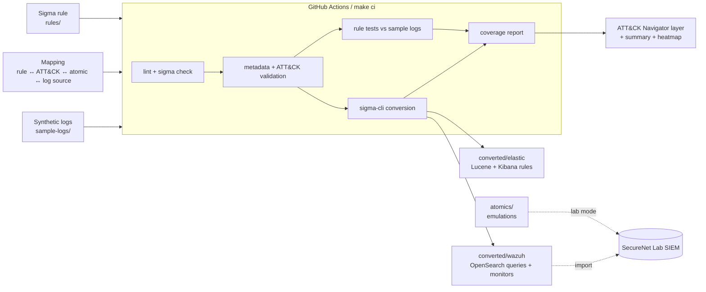
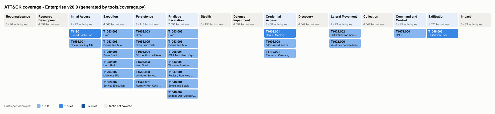

# Detection-as-Code

> Author: **Syed Mustafa Hassan**.
> Several rules are adapted from the SigmaHQ public ruleset - see
> [Rule provenance](#rule-provenance-and-credit).

<!-- CI screenshot: add docs/img/ci-passing.png (green checks of a real Actions run) and
     uncomment:   -->

**Twenty Sigma detection rules, mapped to MITRE ATT&CK and managed like software: version
control, automated validation and tests in CI, generated SIEM queries, and ATT&CK coverage
reporting.**

This is the detection-engineering layer for my
[SecureNet Lab](#integration-with-securenet-lab) (a segmented containerlab network with
Suricata and a SIEM). It also runs **standalone**: clone it, run `make setup && make ci`,
and every rule is validated, converted and tested against the bundled synthetic logs.

---

## How detection-as-code works, and why it matters

SIEM rules that live only in a vendor UI have no review, no tests and no history. A
careless exclusion can blind a rule, and a renamed field can stop it matching. Neither
raises an error, because a broken rule looks exactly like a quiet network. Detection-as-code
treats detections as source code:



1. **Rules are written once in [Sigma](https://github.com/SigmaHQ/sigma-specification)**,
   the vendor-neutral standard, and stored in Git.
2. **Every push runs CI.** It runs YAML lint, `sigma check` (which fails on malformed
   rules), project validation (required metadata, technique IDs that are valid in the
   **pinned** ATT&CK v20.0, consistency with the mapping), and a **self-test** proving the
   gates reject known-bad rules.
3. **Rules are unit-tested.** Each rule is compiled to SQL by pySigma and run against
   synthetic logs. It must match its malicious events and must not match the near-miss
   benign ones.
4. **SIEM queries are generated, never hand-written.** sigma-cli converts each rule for
   Elastic (ECS) and Wazuh (OpenSearch with Wazuh field names). A drift check makes CI
   fail if `converted/` differs from what the rules produce.
5. **Coverage is computed from the rule tags**, as an ATT&CK Navigator layer, a Markdown
   table and a heatmap.
6. **Each rule has an emulation** in Atomic Red Team format, for validation in the lab.

Each stage is explained in [docs/pipeline.md](docs/pipeline.md). The reasoning behind the
design is in the [technical note](docs/technical-note.md).

---

## Rules inventory

Status: every rule is Sigma status `test`. **Synthetic test** means the rule is unit-tested
against `sample-logs/` in CI. **Lab validation** records the outcome of the atomic in the
SecureNet Lab. It is filled in from your own runs and also tracked in
`mapping/detections.yml`. Each rule's logic, tuning and blind spots are explained in
[docs/rules.md](docs/rules.md).

| # | Rule | Origin | Technique(s) | Tactic(s) | Log source | Synthetic test | Lab validation |
|---|---|---|---|---|---|---|---|
| 1 | [Office app spawning shell / script host](rules/windows/process_creation/proc_creation_win_office_spawn_shell.yml) | Adapted from SigmaHQ | T1566.001, T1204.002 | Initial Access, Execution | Sysmon EID 1 | in CI | [FILL FROM YOUR RUN] |
| 2 | [PowerShell -EncodedCommand](rules/windows/process_creation/proc_creation_win_powershell_encoded_command.yml) | Adapted from SigmaHQ | T1059.001 | Execution | Sysmon EID 1 | in CI | [FILL FROM YOUR RUN] |
| 3 | [Scheduled task with suspicious action](rules/windows/process_creation/proc_creation_win_schtasks_create_suspicious.yml) | Similar to SigmaHQ | T1053.005 | Execution, Persistence, Priv. Esc. | Sysmon EID 1 | in CI | [FILL FROM YOUR RUN] |
| 4 | [sc.exe service with suspicious binPath](rules/windows/process_creation/proc_creation_win_sc_create_service_suspicious_path.yml) | Adapted from SigmaHQ | T1543.003 | Persistence, Priv. Esc. | Sysmon EID 1 | in CI | [FILL FROM YOUR RUN] |
| 5 | [LSASS dump via comsvcs.dll MiniDump](rules/windows/process_creation/proc_creation_win_rundll32_comsvcs_minidump.yml) | Adapted from SigmaHQ | T1003.001 | Credential Access | Sysmon EID 1 | in CI | [FILL FROM YOUR RUN] |
| 6 | [Child of PsExec service (PSEXESVC)](rules/windows/process_creation/proc_creation_win_psexec_service_child.yml) | Adapted from SigmaHQ | T1021.002, T1569.002 | Lateral Movement, Execution | Sysmon EID 1 | in CI | [FILL FROM YOUR RUN] |
| 7 | [Child of WinRM host (wsmprovhost)](rules/windows/process_creation/proc_creation_win_winrm_wsmprovhost_child.yml) | Adapted from SigmaHQ | T1021.006 | Lateral Movement | Sysmon EID 1 | in CI | [FILL FROM YOUR RUN] |
| 8 | [Run key to suspicious path](rules/windows/registry_set/registry_set_win_run_key_suspicious_path.yml) | Similar to SigmaHQ | T1547.001 | Persistence, Priv. Esc. | Sysmon EID 13 | in CI | [FILL FROM YOUR RUN] |
| 9 | [UAC bypass via shell-open hijack](rules/windows/registry_set/registry_set_win_uac_bypass_shell_open_command.yml) | Similar to SigmaHQ | T1548.002 | Priv. Esc. | Sysmon EID 13 | in CI | [FILL FROM YOUR RUN] |
| 10 | [Suspicious LSASS process access](rules/windows/process_access/proc_access_win_lsass_suspicious_access.yml) | Similar to SigmaHQ | T1003.001 | Credential Access | Sysmon EID 10 | in CI | [FILL FROM YOUR RUN] |
| 11 | [Web server spawning shell](rules/linux/process_creation/proc_creation_lnx_webserver_spawn_shell.yml) | Adapted from SigmaHQ | T1505.003, T1190 | Persistence, Initial Access | Sysmon for Linux EID 1 | in CI | [FILL FROM YOUR RUN] |
| 12 | [Reverse shell command line](rules/linux/process_creation/proc_creation_lnx_reverse_shell.yml) | Adapted from SigmaHQ | T1059.004 | Execution | Sysmon for Linux EID 1 | in CI | [FILL FROM YOUR RUN] |
| 13 | [Setuid / setgid via chmod](rules/linux/process_creation/proc_creation_lnx_chmod_setuid.yml) | Similar to SigmaHQ | T1548.001 | Priv. Esc. | Sysmon for Linux EID 1 | in CI | [FILL FROM YOUR RUN] |
| 14 | [Read / copy of /etc/shadow](rules/linux/process_creation/proc_creation_lnx_shadow_file_access.yml) | Original | T1003.008 | Credential Access | Sysmon for Linux EID 1 | in CI | [FILL FROM YOUR RUN] |
| 15 | [File upload with curl / wget](rules/linux/process_creation/proc_creation_lnx_curl_wget_file_upload.yml) | Similar to SigmaHQ | T1048.003 | Exfiltration | Sysmon for Linux EID 1 | in CI | [FILL FROM YOUR RUN] |
| 16 | [Cron file created / modified](rules/linux/auditd/lnx_auditd_cron_file_modification.yml) | Similar to SigmaHQ | T1053.003 | Execution, Persistence, Priv. Esc. | auditd PATH | in CI | [FILL FROM YOUR RUN] |
| 17 | [authorized_keys modified](rules/linux/auditd/lnx_auditd_ssh_authorized_keys_modification.yml) | Original | T1098.004 | Persistence, Priv. Esc. | auditd PATH | in CI | [FILL FROM YOUR RUN] |
| 18 | [Web exploitation patterns in URI](rules/network/zeek/zeek_http_web_exploitation_patterns.yml) | Similar to SigmaHQ | T1190 | Initial Access | Zeek http.log | in CI | [FILL FROM YOUR RUN] |
| 19 | [Many SSH auth attempts in one connection](rules/network/zeek/zeek_ssh_password_guessing.yml) | Original | T1110.001 | Credential Access | Zeek ssh.log | in CI | [FILL FROM YOUR RUN] |
| 20 | [Long DNS labels (tunneling)](rules/network/zeek/zeek_dns_long_subdomain_tunneling.yml) | Original | T1048.003, T1071.004 | Exfiltration, C2 | Zeek dns.log | in CI | [FILL FROM YOUR RUN] |

The requested tactics are all covered: Initial Access, Execution, Persistence, Privilege
Escalation, Credential Access, Lateral Movement and Exfiltration.

## ATT&CK coverage



*Generated by `tools/coverage.py` (`make coverage`). Darker cells mean more rules.*

- **Interactive heatmap.** Open the
  [official ATT&CK Navigator](https://mitre-attack.github.io/attack-navigator/), choose
  *Open Existing Layer*, then either *Upload from local* with
  `coverage/attack-navigator-layer.json`, or *Load from URL* with the raw URL of that file
  in this repository. The layer uses format 4.5 and ATT&CK v20, which Navigator 5.3.2 loads.
- **Tables.** [coverage/coverage.md](coverage/coverage.md) has tactic → technique → rule
  tables, generated from the rules.
- **Final coverage numbers, including lab-validated coverage:**
  [FILL FROM YOUR RUN] (see [docs/results.md](docs/results.md)).

---

## Rule provenance and credit

Several rules are adapted from the [SigmaHQ public ruleset](https://github.com/SigmaHQ/sigma)
and then re-tuned, re-tested against this repo's synthetic logs, and mapped to atomics here.
Others only resemble an upstream rule, and four have no upstream counterpart. Each rule was
compared with SigmaHQ at commit
[`05d1031`](https://github.com/SigmaHQ/sigma/tree/05d1031f537e830b76da53bae2400c5814c89165)
and labelled in its own metadata:

| Origin | Count | Meaning | What the rule file carries |
|---|---:|---|---|
| **Adapted from SigmaHQ** | 8 | Same detection logic as a specific upstream rule, modified here | `related: type: derived`, upstream URL in `references`, the original authors in `author`, `license: DRL-1.1` |
| **Similar to SigmaHQ** | 8 | Same behaviour, independently written logic or a different log source | `related: type: similar`, upstream URL in `references` |
| **Original** | 4 | No comparable upstream rule found | - |

Adapted rules remain under the upstream
[Detection Rule License (DRL) 1.1](https://github.com/SigmaHQ/Detection-Rule-License), which
requires keeping the original authors and a link to the source when the rules are shared.
`tools/validate_rules.py` enforces this: a rule marked `derived` without the licence, the
original authors or the upstream link fails CI.

What this project adds around the rules is the engineering: pinned-ATT&CK validation, the
test harness with near-miss benign events, the custom Wazuh and ECS-Linux conversion
pipelines, the coverage tooling and the emulations.

## Quick start

Requirements: Linux, macOS or WSL2 (Ubuntu 22.04 tested target), Python ≥ 3.10, `make`
and `git`. Docker is **not** needed for standalone mode.

```bash
sudo apt install -y python3-venv make git          # once, on Ubuntu/WSL2
git clone <this-repository-url> detection-as-code && cd detection-as-code
make setup        # .venv with the pinned toolchain (requirements.lock)
make ci           # the full pipeline, exactly as in GitHub Actions
```

There is one command for each stage:

| Goal | Command | Output |
|---|---|---|
| Validate rules | `make lint validate` | sigma check, plus metadata, ATT&CK and mapping errors |
| Test rules against sample logs | `make test` | console report, `build/test-report.md` |
| Generate SIEM conversions | `make convert` | `converted/elastic/`, `converted/wazuh/`, `converted/README.md` |
| Build the coverage report | `make coverage` | `coverage/attack-navigator-layer.json`, `coverage.md`, `coverage-heatmap.svg` |
| Prove the gates work | `make selftest` | known-bad rules must be rejected |
| List or dry-run emulations | `make atomics-list`, `python tools/run_atomic.py T1059.004` | printed commands (nothing runs without `--execute`) |
| Query a lab SIEM | `make hunt TARGET=wazuh SINCE=2h` | `build/lab-hunt-wazuh.md` |

### Pinned toolchain

| Component | Version |
|---|---|
| Python | ≥ 3.10 (CI: 3.10 on ubuntu-22.04) |
| sigma-cli | 3.1.0 |
| pySigma | 1.5.1 |
| pySigma-backend-elasticsearch / -opensearch / -sqlite | 2.1.1 / 2.0.3 / 2.0.0 |
| pySigma-pipeline-sysmon / -windows | 2.0.0 / 2.0.1 |
| yamllint | 1.38.0 |
| MITRE ATT&CK Enterprise | v20.0 (`mapping/attack/`, source SHA-256 recorded) |

The full transitive lock is in `requirements.lock`. There are **no secrets in the repo**:
the lab tools read SIEM credentials from environment variables.

## Repository layout

```
rules/                Sigma rules (windows/, linux/, network/zeek/)
converted/            GENERATED SIEM queries: elastic/ (Lucene + Kibana NDJSON), wazuh/ (Lucene, monitors, saved searches)
mapping/              detections.yml (rule ↔ technique ↔ atomic ↔ log source ↔ samples), attack/ (pinned ATT&CK extract)
atomics/              Atomic Red Team-format emulations, one folder per technique
coverage/             GENERATED Navigator layer, coverage.md, heatmap SVG
sample-logs/          SYNTHETIC Sysmon / Sysmon-for-Linux / auditd / Zeek events + generator
pipelines/            custom pySigma processing pipelines (Wazuh field names, ECS for Linux)
config/               conversion targets, sigma validators, yamllint
tools/                validate, test, convert, coverage, run_atomic, hunt_lab, ATT&CK update
tests/fixtures/       intentionally invalid rules for the CI self-test
lab/                  Sysmon (Windows/Linux) and auditd configs for lab mode
docs/                 technical note, pipeline, per-rule logic, lab integration, results
.github/workflows/    detection-ci.yml (every push), attack-watch.yml (weekly ATT&CK check)
```

## Integration with SecureNet Lab

Standalone mode is the default. To validate against real telemetry, follow
[docs/lab-integration.md](docs/lab-integration.md). In short:

1. Deploy the Sysmon and auditd configs from `lab/`, and set up the Zeek JSON logs.
2. Enable Wazuh archives.
3. Import `converted/wazuh/*`.
4. Run the atomics on lab hosts (`DAC_LAB_CONFIRM=isolated-lab`).
5. Run `make hunt`.
6. Record the outcomes in `mapping/detections.yml` (`lab_validation`) and
   [docs/results.md](docs/results.md).

All attack emulation is for the isolated lab only. The runner refuses non-private
targets.

## Results

All results come from your own runs and are recorded in [docs/results.md](docs/results.md):

- Which rules fired in the lab: [FILL FROM YOUR RUN]
- False-positive rates in a benign baseline window: [FILL FROM YOUR RUN]
- Final coverage numbers, including the lab-validated share: [FILL FROM YOUR RUN]

## Lessons learned

These came up while building the pipeline.

- **Pin your threat model.** pySigma validates ATT&CK tags against the *latest* release by
  default. ATT&CK v20 renamed Defense Evasion to *Stealth* and added *Defense Impairment*,
  so an unpinned build would break with no change to the repository. Pinning ATT&CK (and
  checking for upgrades weekly) keeps CI reproducible.
- **Query languages disagree on regex semantics.** Sigma regexes *search*, but Lucene
  regexes are *anchored* and have no `^`. The first DNS-tunneling regex would have passed
  the local test and never matched in the SIEM. Writing patterns that mean the same thing
  in both languages, and testing with the real compiler, matters.
- **Lint catches real bugs.** yamllint flagged that `#{input}` in an unquoted YAML string
  is a comment, which had silently truncated two test descriptions.
- **Filters need tests too.** Every filter has a benign near-miss sample. A deliberate
  mutation (removing the WinRM conhost filter) turned CI red, which is how you know a test
  suite has teeth.
- **Make gaps explicit.** Stock Wazuh cannot decode Sysmon for Linux. Failing those
  conversions loudly, and documenting them, beats generating queries that can never fire.
- **Case sensitivity is a deployment property.** Sigma is case-insensitive, but keyword
  fields in OpenSearch are not. Rule semantics depend on the index mapping as well as on
  the rule.
- Lab-run lessons: [FILL FROM YOUR RUN]

## Future work

- Sigma **correlation rules** for aggregation-based detections (distributed brute force,
  beaconing, volumetric exfiltration) with ES|QL or EQL backends.
- A **Wazuh decoder for Sysmon for Linux**, to close the five unsupported conversions, and
  native Wazuh XML rule generation.
- More telemetry: PowerShell Script Block Logging (4104), Windows service and task events
  (7045, 4697, 4698), auditd `chmod`/`execve` syscall rules.
- An **automated purple-team loop**: a scheduled lab job that runs every atomic, hunts,
  and updates `lab_validation`, so efficacy is regression-tested continuously.
- **Replay of anonymised real lab traffic** as the benign corpus, for statistically
  meaningful false-positive rates.
