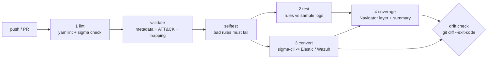

# The CI pipeline, step by step

A Sigma rule is source code. It can contain syntax errors, logic bugs and regressions,
and it can drift away from the SIEM content that is actually deployed. Each pipeline
stage below closes one of those failure modes. Every stage is a `make` target, so it runs
the same way on a laptop (`make ci`) as in GitHub Actions
(`.github/workflows/detection-ci.yml`).

| # | Stage | Command | Fails the build when... | Failure mode it prevents |
|---|---|---|---|---|
| 1a | YAML lint | `yamllint -c config/yamllint.yml ...` | Bad indentation, duplicate keys, tabs | Malformed YAML that parses differently from what the author meant. Duplicate keys silently overwrite each other. This stage caught a real bug while the project was being built: an unquoted `#{...}` in an atomic test was read as a YAML comment. |
| 1b | Sigma check | `sigma check --fail-on-error --fail-on-issues -c config/sigma-validation.yml rules/` | Parse or condition errors (e.g. a condition referencing an undefined selection); any validator issue | Rules that do not compile, dangling or unused detections, wildcards that should be modifiers, invalid ATT&CK tags (`attacktag`), duplicate IDs or titles |
| 1c | Project validation | `tools/validate_rules.py` | Missing or empty required metadata; technique not in the **pinned** ATT&CK; tactic and technique mismatch; mapping inconsistent | A rule that "works" but cannot be triaged, reported or maintained |
| 1d | Self-test | `make selftest` | A known-bad fixture is **accepted** | A broken gate that passes everything (who tests the tests?) |
| 2 | Rule tests | `tools/test_rules.py` | A rule misses an expected malicious event, or fires on a benign one that is not documented as a false positive | Logic regressions (e.g. someone "tunes" a filter and blinds the rule) |
| 3 | Conversion | `tools/convert.py` (sigma-cli per rule and target) | A conversion fails that is not listed in `expected_unsupported` | Rules that are valid Sigma but cannot be deployed to the SIEM |
| 4 | Coverage | `tools/coverage.py` | (generation error) | Coverage claims that do not match the rule set |
| * | Drift | `make drift` (`git diff --exit-code`) | `converted/`, `coverage/` or `sample-logs/` differ from what the sources generate | Hand-edited SIEM queries, and stale reports |

## Stage details

### 1a: YAML lint
yamllint runs before Sigma because the YAML parser is forgiving in dangerous ways. A
duplicated `CommandLine|contains` key inside one selection is legal YAML, but the second
key silently replaces the first, so half the detection logic disappears. With
`key-duplicates` enabled, that is a hard error. Line-length findings are only warnings.

### 1b: `sigma check` (pySigma validators)
`sigma check` loads every rule into pySigma's object model, which is exactly what the
converters do. Any rule it cannot parse could not be converted either. With
`--fail-on-issues` it also enforces all of pySigma's validators except `d3_fendtag` (see
`config/sigma-validation.yml`). Examples:

- `dangling_detection`: a selection that is never used, usually an unfinished edit.
- `all_of_them_condition`: `all of them` silently AND-s filters into selections.
- `wildcards_instead_of_modifiers`: `*foo*` should be written `|contains: foo`.
- `attacktag`: the ATT&CK tags must exist.

**Pinning ATT&CK for `attacktag`.** Out of the box, pySigma downloads the *latest*
ATT&CK release from GitHub at run time. A CI result would then depend on the day it ran.
For example, ATT&CK v20 renamed Defense Evasion (TA0005) to *Stealth* and split out
*Defense Impairment* (TA0112). Every rule tagged `attack.defense-evasion` would have
broken overnight without anyone touching the repository.

`tools/prime_attack_cache.py` avoids this. It fills pySigma's cache from the release pinned
in `mapping/attack/`, so `sigma check`, the Elastic SIEM-rule converter and our own
validator all use the same ATT&CK version, offline.

### 1c: project validation (`tools/validate_rules.py`)
This stage enforces the repository's own definition of a *complete* rule:

- The required fields are present and non-empty: `title id status description references
  author date tags logsource detection falsepositives level`.
- `id` is a canonical UUID, and IDs and titles are unique.
- `description` has at least 80 characters, so the logic is actually explained.
- `falsepositives` is not the placeholder "Unknown".
- The file name follows the log-source prefix convention.
- **ATT&CK:**
  - every `attack.tXXXX` exists in pinned v20.0;
  - revoked or deprecated IDs are reported as such, for example `T1086 is revoked`;
  - every technique is tagged under at least one of its real tactics;
  - every tactic tag is backed by a technique;
  - the references include each technique's attack.mitre.org page.
- **Mapping:**
  - every rule appears exactly once, with matching UUID, techniques and log source;
  - the atomic file and test name exist, and the atomic targets one of the rule's
    techniques;
  - the sample IDs exist, expected matches are labelled `malicious`, and known false
    positives are labelled `benign`.

In GitHub Actions it emits `::error file=...` annotations, so problems show inline on the
PR diff.

### 1d: self-test
`tests/fixtures/invalid/` holds rules that are *meant* to fail:

- One has a condition that references an undefined selection.
- One uses the revoked `T1086` and the retired `attack.defense-evasion` tactic, has a
  20-character description, and has `falsepositives: Unknown`.

`make selftest` passes only if every gate rejects them. Without this check, a mistake in
the gate itself, such as a wrong path, a wrong flag, or an exit code that is swallowed,
would show up as a reassuring green build.

### 2: rule tests (`tools/test_rules.py`)
This is the detection-engineering equivalent of unit tests.

1. Each synthetic JSONL file is loaded into an in-memory SQLite table. The columns are
   `COLLATE NOCASE`, because Sigma matching is case-insensitive.
2. Each rule is converted with **pySigma's SQLite backend**, the same engine sigma-cli
   uses. Windows rules go through the standard `sysmon` pipeline, which adds
   `EventID=1/10/13` for the log-source category, so the pipeline mapping is tested too.
3. The matched `_sample_id`s are compared with `mapping/detections.yml`:
   - `expected_matches` must all fire.
   - Any other hit fails the build, unless it is listed in `known_false_positives`.
   - Corpus-wide, every `malicious` event must be caught by some rule, and every alert
     on a `benign` event must be a documented false positive.

Every filter in the rule set has a benign event that would match without the filter. A
change that weakens or removes a filter therefore turns CI red. A mutation test while
building the project confirmed this: removing the WinRM `conhost.exe` filter made
`win-106` fail.

### 3: conversion (`tools/convert.py` + `config/targets.yml`)
`sigma convert` runs **once per rule per output format**, so one rule's failure cannot hide
another's result, and each SIEM query sits in its own reviewable file:

- **elastic**
  - Backend: `lucene`.
  - Pipelines: `ecs_windows`, `ecs_zeek_beats` and `pipelines/ecs_linux.yml`. The last one
    was written for this project, because there is no upstream ECS Linux pipeline.
  - Outputs: per-rule Lucene queries and a Kibana Security detection-rule bundle (NDJSON)
    that includes the ATT&CK threat mapping.
- **wazuh**
  - Backend: `opensearch_lucene`. The Wazuh indexer is an OpenSearch fork.
  - Pipelines: the upstream `sysmon` pipeline (adds EventID conditions), then
    `pipelines/wazuh.yml`, which maps fields to Wazuh's decoder names, for example
    `CommandLine` to `data.win.eventdata.commandLine`.
  - Outputs: per-rule Lucene queries, OpenSearch Alerting monitors, and a Dashboards
    saved-search bundle.

**Unsupported is explicit, not silent.** Stock Wazuh has no decoder for Sysmon for Linux.
`pipelines/wazuh.yml` therefore raises a `rule_failure` for Linux `process_creation`
rules, instead of emitting queries with field names that could never match. Those five
rules are listed in `expected_unsupported`. Any *other* conversion failure fails the
build. `converted/README.md` is the generated support matrix.

The converted files are **committed** so that reviewers see the SIEM-level effect of a
rule change in the PR diff. The **drift check** then guarantees nobody edits them by hand.
CI regenerates them, and `git diff --exit-code` must be empty. The toolchain is pinned in
`requirements.lock`, which keeps the output deterministic. This was verified by
converting twice and diffing the results.

### 4: coverage (`tools/coverage.py`)
This stage turns the rule tags into:

1. An **ATT&CK Navigator layer** (`coverage/attack-navigator-layer.json`, layer format
   4.5). It has one entry per (technique, tactic) the rules claim, the score is the
   number of rules, the comment holds the rule titles, and the metadata holds the rule
   paths and lab-validation status.
2. A **Markdown summary**: tactic overview, the share of each tactic's techniques covered,
   and tactic to technique to rule tables.
3. A **static SVG heatmap** for the README. Its colour ramp passed a palette validator
   (monotone lightness, light end at least 2:1 against the background).

The scoring rule is the number of rules, not a quality claim. The technical note
discusses why "covered" does not mean "detected".

### Scheduled: ATT&CK watch (`.github/workflows/attack-watch.yml`)
Every week, a job downloads the newest ATT&CK release and validates the rules against
it, without changing the pinned version. This gives early warning of breaking changes in
ATT&CK, such as the v20 tactic split. Upgrading stays a deliberate, reviewed commit.

## Adding a new rule (the workflow this pipeline enforces)

1. Write `rules/<platform>/<category>/<prefix>_<name>.yml`. Generate a fresh UUID
   (`python -c "import uuid;print(uuid.uuid4())"`), tag the technique and its tactic(s),
   and write a real description and false-positive notes. If the rule is adapted from a
   SigmaHQ rule, add `related: [{id: <upstream id>, type: derived}]`, the upstream URL in
   `references`, the original authors in `author`, and `license: DRL-1.1`. The validator
   rejects a `derived` rule without them.
2. Add at least one `malicious` event and one *near-miss* `benign` event to
   `sample-logs/generate_samples.py`, then run `make samples`.
3. Add an atomic test (`atomics/<T#>/<T#>.yaml`) and a mapping entry with
   `expected_matches`.
4. Run `make ci`. Fix anything red, then commit the rule, mapping, samples, atomic,
   `converted/` and `coverage/` together.
5. Run the atomic in the lab, run `make hunt`, set `lab_validation`, and fill in
   `docs/results.md`.
